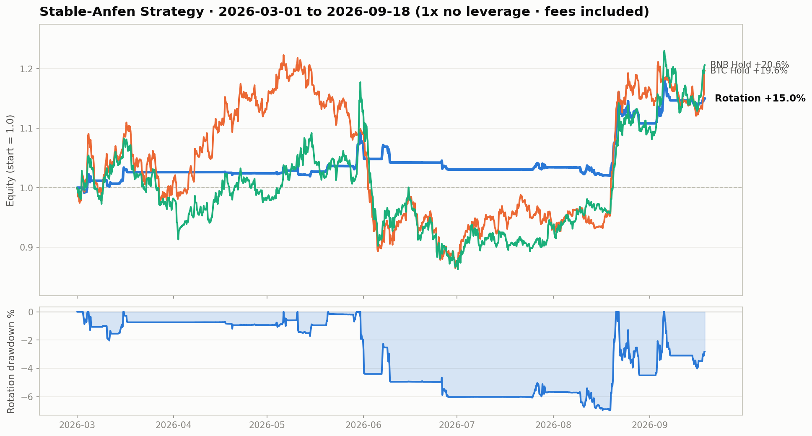

# 稳定安分策略 · Stable-Anfen

**控制回撤，耐心参与趋势。**

面向 BTC 与 BNB 的无杠杆量化策略，以控制回撤为优先。结合机器学习择时、趋势跟随与 70/30 动量轮动，在 4 小时周期上按规则交易。

 [](./LICENSE) 

## 策略如何运作

- **有条件地参与市场**：主策略用机器学习评分筛选入场条件，评分不足时退出；独立的趋势策略捕捉突破机会。
- **把权重交给表现更强的一侧**：比较 BTC、BNB 两套策略近 20 天的净值表现，以 70/30 分配组合权重。
- **保持 1 倍敞口**：两套交易模块均不使用杠杆放大仓位，组合权重合计不超过 100%。

## 示例回测

统计区间：2026-03-01 至 2026-09-18，使用仓库随附数据。

| 指标 | 稳定安分组合 | 持有 BTC | 持有 BNB |
| :--- | ---: | ---: | ---: |
| 累计收益 | **+14.98%** | +19.64% | +20.59% |
| 最大回撤 | **-6.97%** | -29.25% | -26.67% |
| 夏普比率 | **1.81** | 1.13 | 1.14 |

这一样本区间内，组合最大回撤约为直接持币的四分之一。



回测按单边 0.07% 计入交易费用，未计资金费、额外滑点与组合再平衡成本。历史表现不代表未来收益。[查看完整口径](./docs/strategy.md)

## 快速开始

需要 Python 3.10+。仓库已附行情、DVOL 与阈值数据，无需 API Key 即可运行。

```bash
git clone https://github.com/tytaiii/stable-anfen-strategy.git
cd stable-anfen-strategy
pip install -r requirements.txt

# 复现上述样本区间，并与持币比较
python backtest.py --start 2026-03-01 --end 2026-09-18T16:00 --vs-hold
```

运行后输出净值图、收益、最大回撤、夏普比率等统计。修改 `--start` 与 `--end` 可查看其他区间。

```bash
# 可选：更新行情与 DVOL；不更新预计算的 WFA 阈值
python fetch_data.py
```

## 代码与文档

| 文件 | 用途 |
| :--- | :--- |
| [stable_anfen_strategy.py](./stable_anfen_strategy.py) | 评分、择时、趋势跟随与轮动逻辑 |
| [backtest.py](./backtest.py) | 回测、统计与绘图 |
| [fetch_data.py](./fetch_data.py) | 更新 Binance 行情与 Deribit DVOL |
| [策略说明](./docs/strategy.md) | 参数、数据口径与回测边界 |
| [贡献指南](./CONTRIBUTING.md) | 开发环境与测试方法 |

[MIT License](./LICENSE)。本项目用于量化研究，不构成投资建议。
